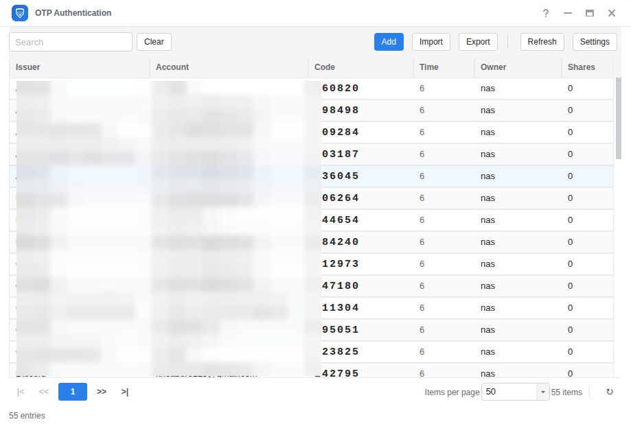

# OTP Authentication

Self-hosted TOTP authenticator vault for Synology DSM 7.x.

- Native DSM desktop app (ExtJS)
- Per-user vault with PIN unlock
- Share codes with other DSM users (view-only)
- Plaintext (`otpauth://`) and encrypted backup/restore
- Uses **system Python 3** (3.8+), ships `cryptography` wheels per CPU



## Build

```bash
python3 -m pip install -r requirements-dev.txt
pytest -q
chmod +x build.sh
VERSION=1.0.0-001 TARGET=x86_64 ./build.sh
```

Artifacts land in `dist/OTPAuthentication-<version>-<target>.spk`.

Targets: `x86_64`, `aarch64`, `armv7`.

## Install (DSM)

Package Center → Manual Install → select the `.spk` matching your NAS CPU.

## Security model

PIN locks the app UI/API. Secrets are encrypted at rest with a package DEK. Root or anyone with both DB and DEK can decrypt. See `docs/security.md`.

## Docs

- [Plan](.cursor/plans/synology_otp_package_3471a2a5.plan.md)
- [Compatibility](docs/compatibility.md)
- [Security](docs/security.md)
- [Privacy](docs/privacy.md)
- [User guide](docs/user-guide.md)
- [Verification](docs/verification.md)
- [Publication checklist](docs/publication.md)

## License

Proprietary source-available — free to use and contribute; redistribution and paid commercialization are not permitted. See [LICENSE](LICENSE).